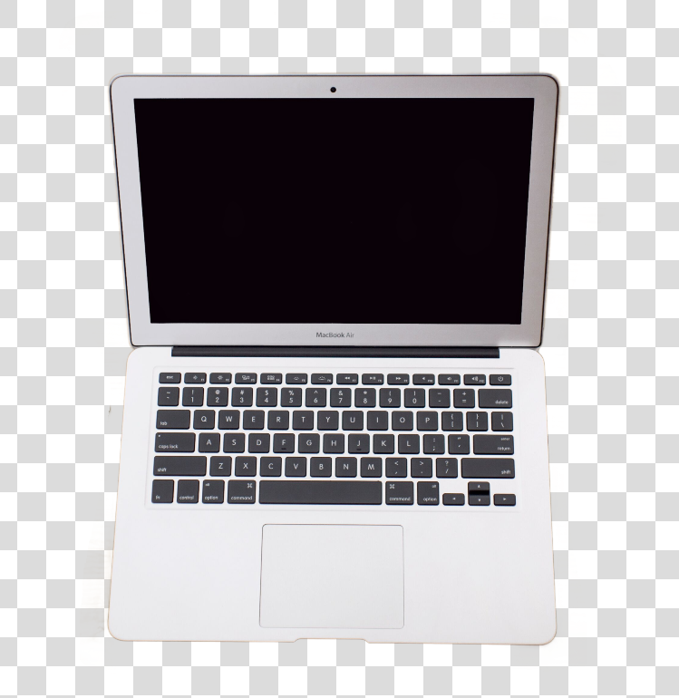
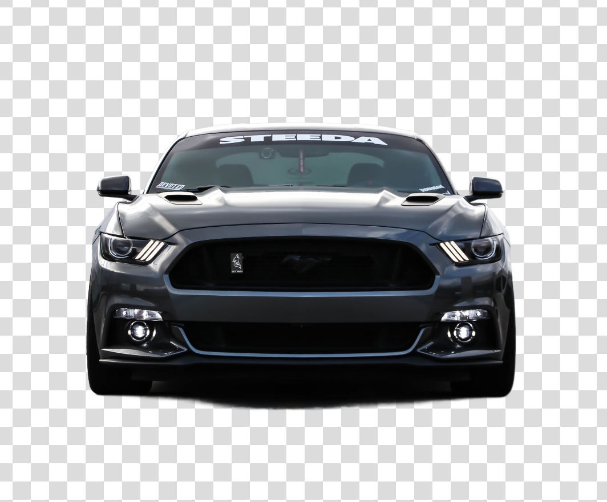

# Krita Smart Select for Windows

A Windows port of [Krita Smart Select](https://github.com/BMFreed/krita-smart-select)
— an AI-assisted lasso selection plugin for Krita that creates soft alpha object
masks locally using BiRefNet HR Matting.

This is a **sister project**, not a fork-and-replace. The original project by
[BMFreed](https://github.com/BMFreed) targets Linux + Krita 5.3.1. This project
adds Windows build support, native DLL packaging, and cross-platform Python
fixes while keeping the C++ plugin source and worker code in sync with upstream.

## Relationship to Upstream

| | Upstream (BMFreed) | This project |
| --- | --- | --- |
| **Platform** | Linux | Windows |
| **Compiler** | GCC | LLVM-MinGW Clang 21 |
| **Qt/Krita deps** | System packages | KDE CI artifact cache |
| **Native artifact** | `kritasmartselect.so` | `kritasmartselect.dll` |
| **Runtime DLLs** | — | `libc++.dll`, `libunwind.dll`, `libwinpthread-1.dll` |
| **License** | GPL-3.0-only | GPL-3.0-only (same) |

**Shared code** (kept in sync with upstream):
- C++ plugin source (`plugin/`)
- Python worker (`worker/`)
- Worker protocol, model config, docs

**Windows-specific** (this project only):
- `scripts/build-windows.bat` — Windows build script
- `scripts/package-windows.ps1` — Windows release packaging
- `docs/windows/build.md` — Windows build documentation
- Cross-platform fixes in `python/smart_select/extension.py` and
  `python/smart_select/worker_launcher.py`

## How It Works

Krita Smart Select is a plugin for Krita 5.3.x that creates soft
AI-assisted selections from a user-drawn region.

It is designed as a local Krita AI selection, object selection and alpha
matting plugin for digital artists.

The tool works like a native lasso selection tool first: draw or adjust the
area around an object, then press `Select object with AI`. The worker runs
BiRefNet HR Matting on the selected crop and applies the returned soft alpha as
a Krita selection.

## Features

- Native Krita canvas tool and Tool Options integration.
- Replace/add/subtract/intersect selection actions through Krita selection
  semantics.
- Soft alpha selection masks instead of binary-only selections.
- Managed user-level Python runtime for inference dependencies.
- Pinned BiRefNet HR Matting model snapshot cache.
- Local structured logs with OpenTelemetry-compatible field names.
- Debug image export for local diagnosis when explicitly enabled.

## Examples

| Before | After |
| --- | --- |
|  |  |

Smart Select preserves transparent surfaces and subtle see-through details, such
as eyeglass lenses.

| Before | After |
| --- | --- |
|  |  |

Soft alpha selection keeps fine hair detail instead of reducing the subject to a
hard binary cutout.

| Before | After |
| --- | --- |
|  |  |

| Before | After |
| --- | --- |
|  |  |

## Requirements

For users:

- Windows 10/11 (x64) or Linux.
- Krita 5.3.x.
- `uv` available in `PATH`.
- Network access for the first runtime and model download.
- NVIDIA driver with CUDA support for GPU inference, or CPU fallback when CUDA
  is unavailable.
- Enough free disk space for the managed runtime and model cache.

For development:

- CMake 3.21+.
- C++20 compiler (GCC on Linux, LLVM-MinGW Clang 21 on Windows).
- Krita 5.3.x source tree and build tree.
- On Windows: KDE Craft + krita-deps-management for Qt5 dependencies.
- Qt5/KF5/Krita development dependencies required by that Krita build.
- Python with `uv`.
- `clang-format`.

The plugin does not install PyTorch, model dependencies or model checkpoints
inside the plugin source tree. Runtime data is stored under Krita user data:

```text
<krita-app-data>/smart_select/
  models/
  runtime/
```

## User Installation

### Windows

Download the Windows release ZIP:

```text
krita-smart-select-windows-x64-<version>.zip
```

Install it from Krita:

1. Open `Tools` -> `Scripts` -> `Import Python Plugin from File...`.
2. Select the release ZIP.
3. Restart Krita.
4. Enable `Smart Select` in the Python Plugin Manager if needed.
5. Select `Smart Select` from the toolbox (it appears in the Select section
   alongside the other selection tools).

The ZIP root contains the Python plugin package:

```text
smart_select/
  __init__.py
  extension.py
  worker_launcher.py
  lib/
    kritasmartselect.dll
    libc++.dll
    libunwind.dll
    libwinpthread-1.dll
```

### Linux

Download the Linux release ZIP from the
[upstream project](https://github.com/BMFreed/krita-smart-select/releases):

```text
krita-smart-select-linux-x64-<version>.zip
```

Install via the same Krita import flow.

On first use, draw or edit a region, press `Select object with AI`, and let the
worker create the runtime and download the model.

The release also includes a `.tar.gz` archive with the expanded install layout
for manual inspection or manual profile installation.

## Development Setup

Create the development Python environment:

```bash
uv venv .venv
uv pip install --python .venv/bin/python -r requirements-dev.txt
```

Build against a Krita 5.3.1 source/build tree:

```bash
KRITA_SRC=/home/bogdan/Work/sources/krita \
KRITA_BUILD=/home/bogdan/Work/build/krita-5.3.1 \
BUILD_JOBS=20 \
./scripts/build-krita-5.3.1.sh
```

The build output is written to:

```text
dist/krita-smart-select/
```

Install the local build into Krita:

```bash
mkdir -p ~/.local/share/krita/pykrita ~/.local/share/krita/actions
rm -rf ~/.local/share/krita/pykrita/smart_select
cp -a dist/krita-smart-select/pykrita/smart_select ~/.local/share/krita/pykrita/
cp dist/krita-smart-select/pykrita/smart_select.desktop ~/.local/share/krita/pykrita/
cp dist/krita-smart-select/share/krita/actions/SmartSelectTool.action ~/.local/share/krita/actions/
```

Package a Linux archive:

```bash
./scripts/package-linux.sh 0.1.0
```

This writes two files into `dist/`:

```text
krita-smart-select-linux-x64-0.1.0.zip
krita-smart-select-linux-x64-0.1.0.tar.gz
```

Publish those archives to GitHub Releases:

```bash
./scripts/create-github-release.sh 0.1.0
```

The release helper expects a clean worktree, creates and pushes tag `v0.1.0`,
then creates or updates the matching GitHub Release with both assets attached.
This is a local release flow because the package contains a native
`kritasmartselect.so` built against Krita 5.3.1. A fully hosted GitHub Actions
release would need a matching Krita build environment or a self-hosted runner.

## Verification

Run the default checks:

```bash
PYTHON=.venv/bin/python ./scripts/test-code.sh
```

This runs Python compile checks, Ruff, mypy, worker unit tests and the C++ core
tests when the Krita source/build tree is available.

Run the opt-in real inference smoke test only when model/runtime setup is
acceptable:

```bash
SMART_SELECT_RUN_BIREFNET_SMOKE=1 PYTHON=.venv/bin/python ./scripts/test-birefnet-smoke.sh
```

## Documentation

- [Product Scope](docs/product-scope.md)
- [Architecture](docs/architecture.md)
- [Worker Protocol](docs/worker-protocol.md)
- [Snapshot And Temporary Files](docs/snapshot-and-temp-files.md)
- [Models](docs/models.md)
- [Runtime Environment](docs/runtime-env.md)
- [Observability](docs/engineering/observability.md)
- [Typing](docs/engineering/typing.md)
- [Testing](docs/engineering/testing.md)
- [Code Style](docs/engineering/code-style.md)
- [Licensing](docs/licensing.md)
- [Contributing](CONTRIBUTING.md)

## Acknowledgements

Krita Smart Select builds on ideas, APIs and open-source work from:

- [Krita](https://krita.org/) and the KDE Krita project, whose native tool,
  selection and plugin APIs make this kind of canvas-integrated workflow
  possible.
- [BiRefNet](https://github.com/ZhengPeng7/BiRefNet), especially the
  `ZhengPeng7/BiRefNet_HR-matting` model used for direct soft-alpha
  extraction.
- [Krita Vision Tools](https://github.com/Acly/krita-ai-tools), which provided
  a useful reference for ML-assisted Krita tooling and user-facing selection
  workflows.
- [CorridorKey](https://github.com/nikopueringer/CorridorKey), which helped
  inform the product direction toward alpha-first, plug-and-play matting.

## License

Krita Smart Select is licensed under GPL-3.0-only. See [LICENSE](LICENSE)
and [docs/licensing.md](docs/licensing.md).
